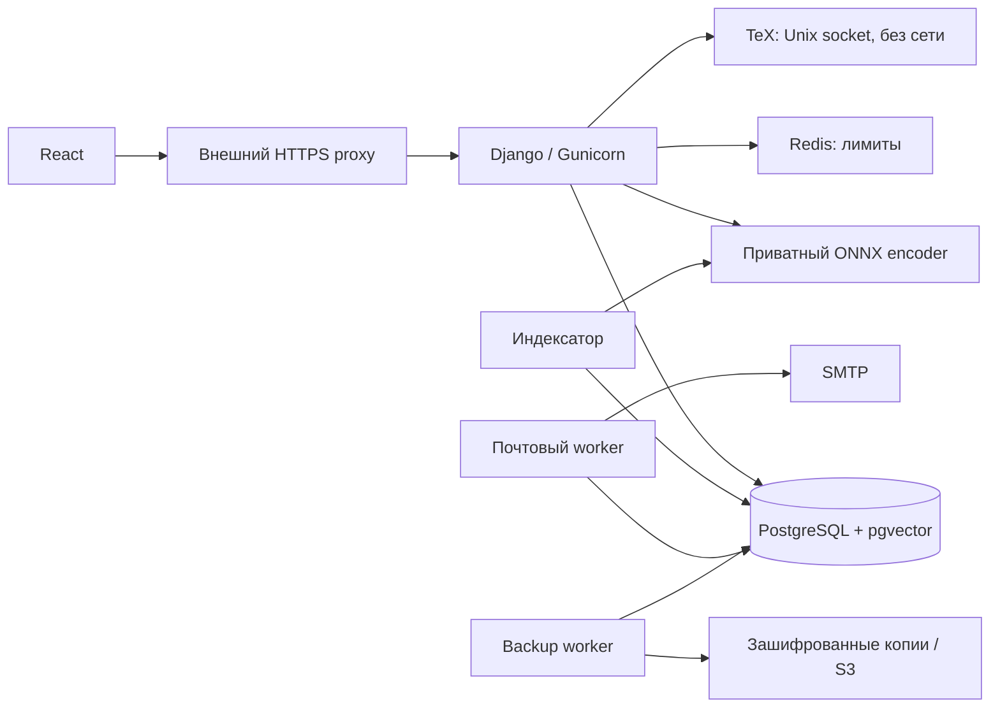

# Реализованная архитектура Plusfolio

Этот документ описывает текущий код, а не целевую систему. Правила продукта — в [product.md](product.md), определения метрик — в [analytics.md](analytics.md), оставшиеся возможности — в [release-roadmap.md](release-roadmap.md). Для изменения кода начните с [руководства разработчика](development.md). Версии библиотек определяют lock-файлы; состав контейнеров и их бюджеты — `compose.yml` и его явно выбранные overlays.

## Процессы и хранение

| Компонент | Реализация и граница ответственности |
| --- | --- |
| Браузер | React/TypeScript, статические файлы Vite. В production отдельный Node-сервер не нужен. Зависимости, шрифты, KaTeX и PDF.js поставляются локально. |
| Web | Django/DRF под Gunicorn. Сессии с CSRF для сайта; API-токены и ограничение read-only для программного доступа. Авторизация всегда на сервере. |
| БД | PostgreSQL 17 с pgvector/pg_trgm в штатном Compose; SQLite только для локальной демки и соответствующих тестов. Схема — `backend/core/models.py` и последовательность миграций. |
| Почта | `EmailOutbox`, `MailBudget`, отдельный процесс `deliver_invitations --watch`. SMTP через настроенный адаптер; ошибки и повторы сохраняются в БД. |
| Поиск | Приватный CPU-процесс ONNX E5, производные документы в PostgreSQL, отдельный индексатор. Redis используется для общих лимитов запросов, а не для хранения учебных фактов. |
| Печать | Отдельный Linux-контейнер Tectonic без сети, секретов и моделей приложения; Unix socket. Локально — sandbox-exec или bubblewrap. |
| Изображения | Нормализованные неизменяемые PNG в `ImageAsset` в БД. Доступ определяется ссылками из разрешённых материалов; общедоступного bucket с картинками нет. |
| Backup | `pg_dump` + исходники/миграции/lock-файлы + модель + доверенные TeX-ресурсы + конфигурация в потоковом tar/age-комплекте. Опционально проверенная S3-копия. PITR/WAL пока не реализованы. |

Демка использует то же предметное ядро, но SQLite, локальный почтовый ящик и вымышленные аккаунты. Переключатель демо-профилей, общие пароли и DEBUG запрещены в production. Настройки режима и обязательные проверки находятся в `backend/config/settings.py`, а не в компонентах интерфейса.

## Где менять поведение

Все пути ниже относительно корня репозитория.

| Код | Ответственность |
| --- | --- |
| `backend/core/api.py`, `api_v1.py`, `tex_api.py`, `search_api.py` | HTTP, аутентификация, валидация входа, преобразование результата. Версионированный API использует то же предметное ядро. |
| `services.py`, `people.py` | Роли, области кружков и материалов, предметные операции, приглашения, отметки. Это источник политик доступа; повторять их в view/search/UI нельзя. |
| `queries.py`, `journal.py`, `filters.py` | Пакетное чтение для сериализаторов, журнал, согласованное применение фильтров после ограничения прав. |
| `worksheets.py`, `issue_updates.py`, `content.py`, `image_assets.py` | Версии листков, явное обновление выдачи, порядок блоков, участие в плюснике, проверка изображений. |
| `analytics.py`, `student_profiles.py` | Назначения и глобальные результаты, знаменатели и дедупликация, индивидуальный отчёт в области взрослого читателя. |
| `search.py`, `catalogue_search.py`, `search_index.py` | Подготовка текста, разрешённые кандидаты, lexical/vector ranking, идемпотентная индексация. |
| `mail_delivery.py`, `mail_backend.py` | Взятие писем, суточный бюджет, повторы и коды ошибок без содержимого секретов. |
| `documents.py`, `document_content.py`, `tex_project.py` | Сборка одного проекта для сервера и автономного предпросмотра; изображения и доступные решения. |
| `tex_runtime.py`, `tex_remote.py`, `tex_cache.py`, `tex_resources.py`, `tex_toolchain.py` | Ограничения задач, транспорт, одноразовые артефакты, подтверждённые ресурсы и контракт архива. |
| `documentation.py`, `api_reference.py`, `robot_workflows.py` | Ролевая справка сайта, OpenAPI и обязательные инструкции ботов. JSON/Markdown и экран справки строятся из одной модели. |
| `frontend/src/main.tsx` и специализированные компоненты | Маршруты и orchestration интерфейса. Чистые расчёты журнала находятся в `journalView.ts`, геометрия — в CSS custom properties, правила тем — в `topicPaths.ts`, роли — в `access.ts`. `materialDetail.ts`/`worksheetCopy.ts` ограничивают продолжения операций текущим экраном. |
| `scripts/server*.py`, `deploy/`, `compose*.yml` | Установка/обновление своего экземпляра, ресурсы, снимки, восстановление и инфраструктурные проверки. |

Перед выделением нового слоя проверьте ближайший модуль. Небольшой чистый helper полезен, если у него одна ответственность и реальные потребители; новый универсальный framework для одной операции не нужен. Стабильный контракт или измеренный лимит оформляется именованной константой. Дублирующиеся значения и демонстрационные ID/даты в рабочем пути недопустимы.

## Инварианты данных и доступа

- `Solve` один на пару школьник/задача и общий для всех кружков. `Discussion` относится к паре кружок/задача. Открытие решения требует разбора и отдельного разрешения показа. Новые плюсы после разбора в этом кружке запрещены, снятие прежнего возможно.
- `WorksheetDocument` — логическая идентичность листка, `Worksheet` — редакция. Публикация/копирование не переписывают старые выдачи. `WorksheetIssue` ссылается на конкретную редакцию и имеет версию для контроля конкурентного редактирования.
- `Assignment` фиксирует получателей выдачи. Выбытие закрывает период участия, но не удаляет назначения и результаты. Массовые назначения выполняются партиями, повторное добавление идемпотентно.
- `WorksheetBlock` хранит порядок текста и задач; `WorksheetItem` — проекцию задач и `include_in_journal`. Отключённая для плюсника задача остаётся в PDF. Нумерация может начинаться с 0.
- Условие и решение авторизуются отдельно через общую политику `services.solutions_for`. Скрытый текст решения не должен попадать в поиск, snippets, PDF, изображения или кэш для другого читателя.
- Учитель и аналитик получают объединение своих взрослых областей. Личная роль школьника не расширяет групповой просмотр. Страницы школьников доступны только взрослым и только в их области назначений/кружков.
- Изменения отметок и выдач проверяют ожидаемую версию под транзакцией. Конфликт нельзя обходить локальным «успехом» или перезаписью актуального состояния. История — `AuditEvent`; универсальной очереди domain events сейчас нет.

[Подробная модель и отличия от исходного проекта](data-model.md). Числовые публичные ID и UUID выполняют разные роли; копия материала получает новую идентичность. Прямой `bulk_update`/`bulk_create` допустим только там, где явно сохранены эти инварианты и индексы поиска.

## Чтение и вычисления

Журнал загружает состав, блоки выдач, глобальные решения и разборы пакетно. Проверки доступа не выполняются отдельным запросом на каждую ячейку. Однократное чтение больших QuerySet должно использовать узкую проекцию и `iterator`; возвращаемый HTTP-ответ всё равно имеет размер соответствующего разрешённого среза.

Аналитика сейчас синхронная: данные назначений группируются по выдачам, множества получателей переиспользуются в пределах одного запроса. Нет долговременного кэша прав или всех исторических когорт. Полное закрытие листка проверяет все требуемые задачи выбранной редакции, а не только совпавшие с поиском. Фильтр разобранных учитывает конкретные кружки: задача остаётся доступной, если есть подходящая выдача в кружке без разбора. Витрины и отдельный аналитический worker — дальнейшее развитие, а не текущая реализация.

Поиск сначала ограничивает объекты и поля правами, затем получает кандидатов; перед выдачей сохраняет эту область. Условия и решения индексируются отдельно. Векторы не являются источником числителя/знаменателя учебных метрик. `ProblemSearchDocument` и `CatalogueSearchDocument` восстанавливаются из материалов; сбой индексатора не должен отменять отметку или выдачу. [Контракт поиска](problem-search.md).

В браузере данные хранятся в состоянии конкретного экрана. Уход со страницы или смена аккаунта отменяют запросы; старый ответ не должен перезаписывать новый. Кэш списка выбора сохраняет текущие варианты и выбранные значения, а не всю историю поисковых страниц. Вычисления по снимку журнала и тем переиспользуются по зависимостям React.

## TeX, память и диск

Сервер и автономный `preview_tex.py` используют одни сборщики проекта. Шаблоны `math-a4-v1/v2`, Tectonic и ресурсы закреплены контрактом. Пользовательский TeX выполняется только offline в изоляции; препроцессор не принимает собственную преамбулу и подключение произвольных пакетов. PNG включаются по авторизованным UUID.

Доверенные ресурсы production-образа находятся в `/app/tex-runtime`, вне постоянного runtime-тома. Они не являются одноразовым PDF-кэшем. Подготовка проверяет оба шаблона, записывает receipt хешей и создаёт точный снимок ресурсов; архив сверяет фактические байты и не публикует неполный ZIP. Любая смена входов контракта требует нового архива и `contract_id`, а не исправления manifest вручную.

Одноразовые артефакты имеют три независимые политики: готовые PDF, ZIP toolchain и временные compiler jobs. Очистка учитывает lease активной задачи, не обходит symlink к ресурсам и не удаляет изображения БД. Ошибка/таймаут убивает процесс компилятора и освобождает слот, временные файлы и дескрипторы. [Формат и лимиты пакета](tex-preflight.md), [формат листка](worksheet-builder.md).

Лимиты CPU/RAM/PIDs, tmpfs и ротация логов заданы каждому контейнеру. Они ограничивают влияние на хост, но не доказывают отсутствие утечки. Для такого вывода нужны повторные вызовы, проверка retained allocations/RSS, дескрипторов, временных каталогов и объёма кэша. Отчёт всегда указывает набор данных, платформу и вид измерения; короткое чтение счётчиков рабочего сервера не называется нагрузочным тестом.

## Выпуск и сопровождение

`release.json` — источник номера/статуса продукта; `scripts/release.py` синхронизирует frontend mirrors. Версии API, миграций, TeX и модели поиска независимы. Подготовительный локальный тег может быть уточнён по запросу до публикации; опубликованные теги не перемещаются.

`server.py update` останавливает пишущие web/mail/indexer, делает свежую полную копию, запускает migrate/initialize и затем остальные службы. Ошибка бэкапа отменяет переход. Откат кода не равен восстановлению данных. Серверные скрипты работают только со своим Compose project и не выполняют глобальный prune или перезапуск Docker. [Установка и восстановление](server-deploy.md), [состав резервной копии](backups.md).

Тесты используют вымышленные данные и отдельные каталоги/БД. Локальная SQLite-регрессия, проверки утилит с mock Docker, реальная offline-компиляция и Linux/PostgreSQL-интеграция — разные уровни доказательства. Их результаты записываются отдельно. Текущие измерения — в `docs/benchmarks/`, команды и обязательные проверки при изменениях — в [development.md](development.md).
