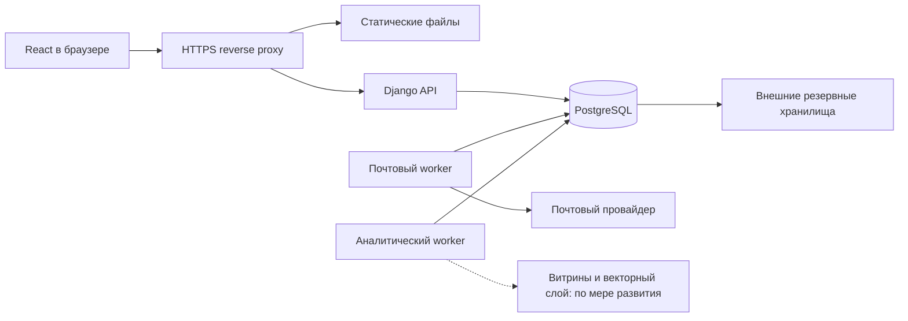

# Архитектура и деплой Plusfolio

Выбрана архитектура модульного Django-backend с PostgreSQL и браузерным интерфейсом React. Backend отвечает за учебные операции, права и сложную аналитику; фоновые процессы используют тот же код, но отдельные очереди и ограничения ресурсов.

Целевая архитектура описана ниже. Локальная демка уже реализует основные операции на Django/DRF + React; для запуска без инфраструктуры использует SQLite и локальный почтовый ящик. Перед размещением — PostgreSQL, почтовый worker и обязательные эксплуатационные проверки. Отличия перечислены в [этапах выпуска](release-roadmap.md).

## Технические решения

| Часть | Выбор |
| --- | --- |
| Интерфейс | React + TypeScript, Vite; статическая сборка с одного домена с API |
| Backend | Django 5.2 LTS + Django REST framework, собственный User с email-логином |
| Основная БД | PostgreSQL, поддерживаемая стабильная ветка; для нового развёртывания — 18 при совместимости выбранного хостинга/расширений |
| Формулы | KaTeX в обычном тексте; необязательные TeX-фрагменты условия и решения |
| Печатные листки | Tectonic 0.17.0, многофайловый TeX, TikZ, локальная изолированная сборка и закрытый PDF-кэш |
| Очереди первого этапа | Outbox и фоновые задания в PostgreSQL; worker из того же backend-образа |
| Сложные расчёты | SQL и отдельный Python-модуль аналитики, затем витрины и фоновые расчёты |
| Почта | API транзакционного провайдера через адаптер; отдельный почтовый worker |
| Векторный слой | Позже pgvector, с интерфейсом для замены на отдельное векторное хранилище |
| Файлы | После появления вложений — закрытое объектное хранилище с версиями и внешними копиями |
| Резервирование | Полные комплекты сервиса, PostgreSQL full/differential + WAL/PITR, две независимые резервные копии |

Django 5.2 имеет длительную поддержку; при реализации берётся актуальный исправленный выпуск ветки и совместимые библиотеки, версии фиксируются lock-файлами. [Поддержка Django 5.2](https://docs.djangoproject.com/en/5.2/releases/5.2/). Vite создаёт статическую браузерную сборку, поэтому отдельный Node-сервер в рабочей среде не нужен. [Production-сборка Vite](https://vite.dev/guide/build.html).

Python выбран также ради будущих статистических и исследовательских расчётов. Агрегация и дедупликация больших объёмов выполняются в БД; загрузка всех строк в память web-процесса не является основным способом аналитики. Интерфейс получает результат и параметры расчёта, а не самостоятельно считает метрики из полного журнала.

## Схема



Один репозиторий и один релиз приложения, без сетевого разделения предметных модулей. Раздельные worker нужны для того, чтобы долгий отчёт не задержал инвайт или сохранение отметки. Дополнительная специализированная очередь появляется только при измеренной необходимости; контракт заданий и атомарный outbox сохраняются.

## Границы модулей

| Модуль | Ответственность |
| --- | --- |
| Аккаунты и доступ | Вход, роли, сессии, политика объектов и управление администраторами |
| Кружки | Создание, география, преподавание, участие и операции по email |
| Таксономия | Три справочника тегов, общее дерево тем задач/листков, версии дерева, область аналитиков |
| Материалы | Черновики, неизменяемая публикация, копирование задач и листков |
| Выдачи | Выдача кружку, персональные назначения, аннулирование ошибок |
| Результаты | Глобальные да/нет решения, локальные да/нет разбора и показ решения школьникам |
| Аналитика | Определения метрик, SQL/витрины, задания, исторические срезы и экспорты |
| Поиск | Текстовый поиск, позже векторные адаптеры и индексация |
| Доставка и аудит | Почтовый outbox, domain events, аудит изменений |

Изменения идут через предметные операции: создать кружок, добавить школьника по email, опубликовать материал, выдать листок, отметить решение. Административный интерфейс использует те же операции и не обходит неизменяемость и аудит.

Правило чтения решений задаёт `services.solutions_for(user, problems, circle)`. Одиночная проверка, пакетная сериализация, PDF и поиск используют эту выборку; отдельной копии политики в поиске нет. Контекст кружка ограничивает показ школьнику, область аналитика определяется его тегами, сочетания ролей дают объединение прав. Доступ вычисляется заново при запросе, без межпользовательского кэша.

Создание кружка проверяет отдельную capability `circle.create`: сейчас её имеет администратор. Если позднее возможность получит учитель, не понадобятся другая сущность кружка или перенос данных. Назначение тегов кружка и область аналитика останутся самостоятельными правами.

Компоненты используют общие `TopicNode`/`Topic` из `frontend/src/topicPaths.ts` и тип `Role` с подписями из `frontend/src/access.ts`. Проверка доступности темы строит индекс родителей один раз на снимок каталога. Фильтр ролей в `people.role_query` опирается на справочник `ROLES`; он же используется для SQL-счётчика активных администраторов. Установка и восстановление читают и записывают конфигурацию через одни `read_env`/`write_env` с явным путём и сохранением прав файла.

## Транзакции и API

### Журнал

Один запрос получает выдачу, страницу школьников, задачи листка, текущие глобальные результаты разрешённых пар и разбор кружка. Отдельных запросов на каждую ячейку нет.

Изменение содержит конечное да/нет и ожидаемую версию. Сервер проверяет текущие права и связи, изменяет состояние, записывает domain event и аудит одной транзакцией. Конфликт возвращает фактическое значение; отмена также не затирает более новую запись.

### Материалы и выдачи

Публикация фиксирует объект, темы и теги. Опубликованные данные защищаются на сервере и на уровне БД; копирование создаёт новые ID. Уникальная пара кружок + листок запрещает повторную выдачу. Персональные назначения фиксируют когорту для аналитики и не исчезают при выбытии школьника.

У задач и листков общая таблица тем с parent_id и отдельные связи многие-ко-многим. Административные изменения дерева сериализуются с созданием версии каталога, а фильтр ветки разворачивается в множество topic_id. Потомки и путь читаются рекурсивным SQL; производный кэш предков/потомков добавляется по измерениям. Правила дерева и версий — в [темах](topics.md).

### Регистрация и состав

Приглашение и задание письма создаются атомарно. Принятие повторно проверяет роль отправителя и область под блокировкой инвайта; аккаунт, профиль и доступ создаются один раз. Для зарегистрированного школьника прямое добавление по email сразу создаёт участие, не требуя нового инвайта.

### История и фоновые слои

Текущие таблицы остаются основным состоянием. События с версией схемы и стабильным event_id позволяют пересчитывать аналитику и перестраивать поиск. Доставка события и выполнение задания допускают повтор, поэтому обработчики идемпотентны. Полная событийная архитектура для всех чтений не нужна.

## Аналитика и векторное расширение

Подробности вынесены в [аналитику](analytics.md). Начальный слой — параметризованный SQL в PostgreSQL; сложные отчёты идут в worker с таймаутами, квотами и отдельным пулом подключений. Частые отчёты используют витрины, сохраняющие круг доступа и свежесть.

При росте нагрузки можно независимо вынести аналитические вычисления и добавить OLAP-хранилище. Векторный поиск — отдельный производный индекс по материалам: сначала pgvector, далее при необходимости другой движок через адаптер. Он не заменяет точные факты выдачи и решения и не используется для знаменателей метрик.

У каждого слоя явные источник, версия и обработанная граница данных. Неуспешная индексация не блокирует занятие. Права проверяются по текущей основной БД, даже если витрина или индекс ещё не успели обновиться.

## Деплой

Для локальной демки — SQLite без Docker и перехват писем. Следующий этап — PostgreSQL и тесты на её блокировках. Для пилота допустим VPS с отдельными процессами приложения, worker, PostgreSQL и reverse proxy; резервные копии вне VPS. Для регулярной эксплуатации предпочтительна отдельно размещённая или управляемая PostgreSQL.

Все рабочие ресурсы располагаются в России: серверы, БД, почта, файлы, логи, мониторинг, резервные копии и будущие векторные/аналитические компоненты. Браузер не загружает шрифты, библиотеки или счётчики с зарубежных CDN. Проверенные тарифы и два варианта первой версии — в [бюджете](hosting-budget.md). Покупка ресурсов и развёртывание пока не выполняются.

Один HTTPS-домен, БД во внутренней сети, серверные сессии и CSRF-защита. Production работает через WSGI/ASGI-сервер, без debug и с секретами вне кода. Перед выпуском применяются штатные проверки развёртывания. [Deployment checklist Django](https://docs.djangoproject.com/en/5.2/howto/deployment/checklist/).

## Релизы и эксплуатация

Проверки → неизменяемый собранный образ → тестовая среда → проверка миграций → выпуск. Миграции запускаются отдельным единственным шагом. Изменения схемы по возможности совместимы с предыдущим образом; откат кода не обещает обратимость изменений данных.

Наблюдаемость: задержка сохранения журнала, ошибки и конфликты; очередь и доставки почты; время/память аналитических заданий; свежесть витрин и индекса; соединения, диск и рост БД; полнота бекапов и отставание WAL. Логи не содержат пароли, токены и лишние персональные данные.

Рассылка подробно описана в [механизме доставки](email-delivery.md). Полные копии, защита ключей, сроки, RPO/RTO и проверка восстановления — в [резервировании](backups.md). Они входят в критерии запуска, а не остаются задачами «после MVP».

## Безопасность и проверки

Markdown очищается, произвольный HTML отключён, KaTeX работает с ограничениями доверенных команд и расширения макросов. Ошибка формулы отображается как текст. [Безопасность KaTeX](https://katex.org/docs/security.html).

Тестовая среда использует искусственные данные и не рассылает реальные инвайты. До пилота с данными детей определяются необходимый набор полей, регион размещения, способы приглашения и сроки хранения/удаления. Это организационные условия запуска, не юридическое заключение.

Проверки реализации охватывают предметную модель и теги, общее дерево тем без циклов и дублей в агрегатах, роли и чужие ID, двукружковую глобальную решённость, неизменяемость, повторную выдачу, email-добавление и выбытие, конкурирующие отметки/инвайты, отчётные знаменатели, сбои worker, пересчёт витрины и полное восстановление.

Глобальный редизайн можно продолжить после проверки механики. Локальная демка задаёт первый рабочий интерфейс со списком кружков на главной, журналом, материалами, деревом тем и аналитикой.

## TeX и PDF

Задача хранит обычные условие/решение и независимые необязательные `statement_tex` / `solution_tex`. Листок фиксирует `template_version=math-a4-v1`. Сборщик создаёт проект:

```text
main.tex             → variables.tex + template.tex
variables.tex        → название листка, описание, кружок, дата, номер
template.tex         → преамбула, шрифты, TikZ, разметка
problems.tex         → нумерованный список файлов задач
tasks/001-<id>.tex    → один файл на условие
solutions.tex        → список разрешённых решений с исходными номерами
solutions/001-<id>.tex
```

Отсутствующий TeX заменяется экранированным обычным текстом; встроенные формулы `$…$` сохраняются. Нельзя вставлять `documentclass`, `usepackage` или собственный `document`: библиотека пакетов задаётся доверенной версией шаблона. Включены amsmath/amssymb, enumitem, TikZ и библиотеки calc, angles, quotes, intersections, positioning, arrows.meta, decorations.markings, shapes.geometric, patterns, babel. Дополнительные пакеты добавляются изменением версии шаблона и прогревом на стенде. Загрузка внешних изображений/пользовательских вложений пока не реализована.

В библиотеке параметры равны «НАЗВАНИЕ КРУЖКА», «ДАТА ВЫДАЧИ», «НОМЕР ЛИСТОЧКА»; в кружке — значения конкретной выдачи. Номер присваивается последовательно под блокировкой кружка, без перенумерации прошлых выдач. Выгрузка `.tex` разворачивает только сгенерированные включения и создаёт автономный файл. ZIP сохраняет структуру проекта. Шаблон и исходники включены в резервные комплекты.

Выбран закреплённый Tectonic 0.17.0. `scripts/setup_tex.py` получает официальный бинарник для macOS arm64 / Linux x86_64 / Linux aarch64, проверяет SHA-256, прогревает доверенный шаблон с кириллицей и TikZ и выполняет повторную сборку `--only-cached`. Никаких пользовательских материалов при прогреве нет. На проверенном Mac бинарник занял 51,5 МиБ, кэш — около 46 МиБ; размер на Linux проверяется при подготовке его образа. Полный TeX Live устанавливать не требуется. [Установка Tectonic](https://tectonic-typesetting.github.io/book/latest/installation/), [параметры компиляции](https://tectonic-typesetting.github.io/book/latest/v2cli/compile.html).

Во время пользовательской сборки сеть запрещена, окружение содержит только служебные параметры, `--untrusted --only-cached` дополняются изоляцией ОС. На Linux используется bubblewrap с отдельными пространствами имён, только проектом, компилятором, кэшем и системными библиотеками/шрифтами внутри. БД, домашние директории, ключи и переменные приложения в окружение не попадают. macOS использует sandbox-exec: запрещены сеть, чтение пользовательских/прикладных каталогов и других временных файлов, запись вне временного проекта. Если средства изоляции или компилятор отсутствуют, PDF возвращает 503; исходники остаются доступны преподавателю. Предусмотрены лимиты: 300 задач, 2 МиБ разрешённых исходников, 30 000 символов на фрагмент, 20 секунд на сборку, 12 секунд CPU, 16 МиБ PDF, два процесса на web-процесс; на Linux память ограничена 1 ГиБ.

Авторизация выполняется перед чтением любого кэша. Для школьника разрешённые решения определяются по действующему участию и флагу показа хотя бы в одном его кружке; скрытые исходники даже не включаются в проект. PDF-кэш закрыт от прямой раздачи и привязан к полному разрешённому проекту, шаблону и версии компилятора. Отзыв показа/участия меняет маску и ключ. PDF и ссылки имеют приватную политику без браузерного хранения. Преподаватель/администратор скачивает TeX/ZIP, остальные роли — только разрешённый PDF.

Локальная демка собирает по запросу и кэширует. Перед размещением выделяется отдельный PDF-worker с общей очередью/квотой на весь сервис, ограничениями контейнера и закрытым хранилищем; ограничение в два процесса в демке действует на один процесс приложения. Linux-образ с bubblewrap, кириллицей, TikZ и теми же ограничениями необходимо прогнать на серверном стенде. Доступ к сборке не требует внешнего API, материалы остаются на российских ресурсах. Образ компилятора, кэш пакетов и версия шаблона включаются в полный production-комплект восстановления.

Браузерный предпросмотр использует PDF.js 6.4.299 из локальной сборки: отдельный worker загружается с того же сервера, страницы рисуются по одной с навигацией, без стороннего CDN и зависимости от встроенного PDF-плагина браузера.

## Измеренная оптимизация чтения и памяти

Проверено 22.10.2026 на локальной SQLite: 100 дополнительных вымышленных кружков, 1 000 задач, 50 листков и 20 000 назначений плюс стандартный демонстрационный набор. Данные создавались в отдельной временной БД, пользовательская демка в нагрузочном прогоне не участвовала. Время — медиана трёх чтений в одном окружении; SQL считается после аутентификации. Это замер локального стенда, не прогноз времени PostgreSQL.

| Сценарий | SQL до → после | Время до → после, мс |
| --- | --- | --- |
| Список кружков преподавателя | 717 → 3 | 123.5 → 11.2 |
| Кружки, учитель + аналитик | 920 → 3 | 183.0 → 11.7 |
| Доступные задачи школьника | 603 → 4 | 367.5 → 38.1 |
| «Мои задачи» | 305 → 5 | 80.6 → 52.2 |
| Банк листков | 162 → 4 | 35.3 → 8.1 |
| Выданные листки школьника | 205 → 2 | 38.9 → 15.7 |
| Журнал школьника | 408 → 10 | 131.3 → 36.1 |
| Аналитика преподавателя | 14 → 14 | 3847.0 → 587.5 |
| Личный кабинет школьника | 8 → 8 | 10.0 → 6.2 |

Полные JSON-ответы 22 сценариев для администратора, преподавателя, школьника, аналитика и совмещённых ролей совпали с исходными ответами на одной и той же БД при фиксированном времени. Сохранялись порядок списков, поля, метрики, видимость решений и области доступа. Все 135 backend-тестов и три теста путей тем прошли.

Убраны запросы на каждую строку списка: права кружков и счётчики читаются одним агрегатным запросом, преподаватели/теги загружаются пакетно, права на решения проверяются сразу для набора задач. Проверки прав не кэшируются между запросами. Проверка существования через EXISTS заменяет размножающие строки JOIN там, где нужны только наличие связи или разрешённая область. В списках листков читаются только ID задач, без лишних экземпляров ORM. В журнале повторяющиеся задачи загружаются отдельным общим пакетом и сериализуются по одному разу на ID; тексты не размножаются в ORM на каждый листок.

В аналитике отбор назначений по задачам листка использует EXISTS. Итоги тем агрегируются по уникальным получателям каждой задачи, сохраняя прежнюю дедупликацию веток и пар школьник × задача; повторные обходы одних пар убраны. Для расчёта читаются только нужные названия и связи тем, без текстов условий и решений.

Миграция 0006 добавляет восемь индексов для действующих участий/преподаваний, назначений школьника, решённых задач, открытых решений, порядка выдач и свежих опубликованных материалов. Состав сущностей и ограничения уникальности не меняются. После применения в демке выполняется PRAGMA optimize и проверка целостности; PostgreSQL использует те же Django-индексы и проверяется отдельно при размещении.

На клиенте карта тем и готовые пути повторно используются внутри неизменяемого снимка каталога (WeakMap); новый массив каталога создаёт свежий индекс. Переименование, перенос, «Прочее» и обработка циклов проверены отдельно. Разметка и поведение выбора не менялись.

Резервирование сохраняет прежний зашифрованный формат plusfolio-demo-v1. Каталоги зависимостей исключаются до обхода, исходники и Tectonic читаются порциями по 1 МиБ, проверка и восстановление больших файлов также потоковые. ZIP и шифрование Fernet по-прежнему используют общий буфер; ограничение порции не означает постоянную память всего процесса.

Проверка бюджетов запросов и большого журнала без пользовательских данных: `.venv/bin/python backend/manage.py test core.test_performance`. Проверка путей каталога: `npm --prefix frontend test`.

## Личные листки и сохранение выданных версий

`WorksheetDocument` — стабильная сущность рабочего пространства: автор, текущая редакция, опубликованная редакция и источник копии. `Worksheet` остаётся неизменяемым снимком с темами, тегами, шаблоном и упорядоченными ссылками на задачи. Создание и редактирование личного листка не публикуют его. Администратор публикует только проверенную текущую редакцию; проверка ожидаемого номера версии защищает от устаревшего сохранения и публикации. Авторство при публикации не меняется.

`WorksheetIssue` ссылается на точный снимок и на документ. Ограничение `(circle, document)` запрещает повторную выдачу после изменения редакции. Сохранение новой версии не меняет предыдущие снимки, выдачи, назначения, знаменатели аналитики или исходники печати. Старый опубликованный снимок остаётся в общей библиотеке до явной публикации нового.

API разделяет каталог (`public`, `mine`, `all` для администратора) и доступ к конкретной версии. Личные снимки доступны автору и администратору, выданные — также в пределах прежних прав кружка/личных назначений. Копирование не расширяет доступ к решениям: они проверяются заново по действующим правам при каждом чтении и сборке. Новая копия получает отдельный документ, автора-получателя и личную первую версию.

Миграция `0007` создаёт документы для существующих листков без замены их UUID, задач, выдач и публикаций. Автоматическое обратное преобразование намеренно запрещено: старый код не умеет ограничивать личные редакции; для полного отката используется проверенный комплект восстановления.


## Оптимизация 28.10.2026

Счётчики кружка считают школьников и выдачи независимыми подзапросами: соединение двух коллекций больше не создаёт произведение строк. Для опубликованных задач и листков миграция `0014` заменяет индексы на `(created_at DESC, id DESC)`, совпадающие с порядком пагинации. Аналитика читает только используемые поля связанных школьников, листков и кружков.

Синхронизация поисковых документов выполняется пакетами до 100 строк в общей реализации `core/search_index.py`. Сверка читает отпечатки без векторов; неизменённые векторы сохраняются, изменённые сбрасываются для повторной индексации. Изменение родительской темы обновляет пути потомков пакетно. Права доступа продолжают проверяться исходными запросами перед поиском.

На отдельной SQLite с 100 кружками, 150 школьниками и 60 выдачами в каждом кружке медиана чтения списка сократилась с 190,5 до 5,76 мс. Для 502 тем повторная синхронизация использует 20 SQL-запросов вместо 504; после переименования ветки — 26 вместо 1005. Это локальный синтетический замер, а не оценка серверной мощности. Результаты: [JSON](measurements/read-optimization.json); повторить без открытия рабочей БД: `.venv/bin/python scripts/benchmark_reads.py`.

На клиенте кабинет, аналитика и два раздела документации загружаются отдельными модулями. Начальный JS-файл уменьшился с 678 501 до 610 082 байт (gzip: 197 443 → 180 683); остальные модули загружаются при открытии разделов. Устаревшие GET-запросы отменяются при смене страницы; повторный рендер неизменного текста с формулами пропускается. TypeScript проверяет неиспользуемые переменные и параметры.


## Переиспользование TeX-ресурсов и сборок

Получение контракта TeX кэширует только SHA-256 доверенных исходников и ресурсов. Ключ содержит путь, устройство/inode, размер, mtime и ctime; изменение, добавление, удаление или атомарная замена файла обнаруживаются при следующем запросе. Объём кэша ограничен 4096 записями на процесс. Состав экспортируемых файлов каждый раз проверяется заново, авторизация API выполняется до построения контракта. Архив собирается по тому же списку файлов без повторного обхода каталога.

Поисковая сверка строит пути дерева тем только при наличии отсутствующих поисковых документов; простаивающий worker не загружает весь каталог ради пустого пакета. Неявные импорты всех моделей в API и сервисном слое заменены явными зависимостями. Настройка кэшей контейнерной сборки описана в [серверной инструкции](server-deploy.md#повторная-сборка).


Измерения этой итерации: [JSON](measurements/deployment-cleanup.json). На macOS arm64 десять обращений к TeX-контракту сделали 467 чтений для хеширования вместо 4670; медиана сократилась с 39,85 до 10,89 мс. На Linux arm64 образ приложения занимает 652 МБ по `docker image ls` против 767 МБ у ранее проверенного серверного образа. Повторная сборка трёх неизменённых образов с готовым кэшем заняла 3,0 с; это замер тёплого кэша, а не первого развёртывания.


## Аналитика по группам получателей

Получатели читаются потоком `(issue_id, student_id)` порциями по 2000 строк; метаданные выдачи с UUID кружка и листка загружаются один раз на выдачу. Каждая выдача сначала сворачивается в группу школьников. Задачи с одинаковой группой получателей разделяют неизменяемый `frozenset`; результат объединения повторно используется только в пределах текущей выдачи. Полный список назначений и множества кортежей школьник × задача больше не создаются. Глобальная решённость, дедупликация между листками/кружками, полное закрытие листка по всем его задачам и отдельный учёт разборов сохраняются. Права по-прежнему определяет исходная выборка назначений; группы не кэшируются между запросами.

Счётчики кружков и ролей в кабинете считаются одной агрегатной выборкой. Общие и авторские счётчики материалов совмещены для аккаунтов с несколькими ролями. Личные задачи выбираются через множество выданных листков: одинаковый листок, полученный в нескольких кружках, не размножает строки до дедупликации.

На отдельной SQLite с 60 кружками, 80 школьниками, 25 общими листками, 80 задачами и 120 000 назначениями медиана аналитики сократилась с 2098,84 до 176,64 мс. Пик выделений Python по tracemalloc — с 82,96 до 6,11 МиБ; это не полный RSS процесса. Число SQL-запросов аналитики изменилось с 13 до 14: добавлена небольшая выборка метаданных выдач. В сводке кабинета запросы сократились с 18 до 12 для всех совмещённых ролей, с 7 до 5 для школьника, с 10 до 8 для преподавателя. Аутентификация и сериализация профиля в эти числа не входят.

Полные ответы совпали с предыдущим коммитом в 13 сценариях для разных ролей, нескольких кружков, городов, тем, тегов и пустой выборки. [Результаты](measurements/report-cohorts.json). Воспроизведение без рабочей БД: `.venv/bin/python scripts/benchmark_reports.py --baseline-ref 6b1fb51`; нужен Git с историей исходного коммита. Это синтетический локальный замер, не оценка мощности production-сервера.


## Выгрузка журнала

Формирование Excel переиспользует шрифты, выравнивания, заливки и границы внутри одной книги. Ранее одинаковые объекты оформления создавались заново для каждой ячейки. Для экспорта задачи загружаются только с ID и полями, необходимыми для названия; условия, решения, TeX, аккаунты авторов, темы и теги не читаются. Экранный журнал по-прежнему получает полный набор полей. Выбор выданных редакций, поиск школьников, права и содержимое файлов сохранены; новых миграций или зависимостей нет.

На синтетическом журнале из 150 школьников и 16 листков по 20 задач (337 колонок с итогами) медиана формирования Excel сократилась с 3869,65 до 1120,68 мс. Пик выделений Python самой книги остался около 21,56 МиБ. Отдельный замер загрузки снимка с 320 уникальными задачами по 56 000 символов исходников: 58,17 → 27,94 мс, 30,01 → 1,43 МиБ по tracemalloc, 10 → 8 SQL-запросов. Это два отдельных сценария, не замер полного RSS или мощности сервера; аутентификация и поиск самого кружка в число запросов не входят.

Сравнены все XML-части шести вариантов Excel, включая оформление, содержимое, размеры и параметры печати; исключены только времена создания и сохранения книги. Пять вариантов TSV совпали побайтно, снимки журнала — целиком. [Результаты](measurements/journal-export.json). Воспроизведение без рабочей БД: `.venv/bin/python scripts/benchmark_exports.py --baseline-ref 950262e`; требуется история исходного коммита.
