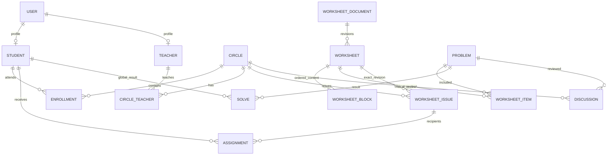

# Модель данных Plusfolio

Здесь описана реализованная схема. Поля, ограничения и индексы определены в `backend/core/models.py`; их изменения проходят через миграции. Предметные проверки доступа и переходов находятся в сервисах, а не только в `Model.save`: прямой `QuerySet.update` не заменяет разрешённую операцию приложения. Исторические проектные сущности, ещё не реализованные, перечислены в конце.

## Связи и идентичность

UUID задачи/кружка/документа — идентичность для связей. Короткие P-/C-/W-/TOP-/INV-ID — номера для человека, выделяемые БД через отдельные таблицы `*Number`; они не заменяют UUID в API. У профиля школьника собственный числовой ID. `Problem.source`, `source_id`, `source_url`, `source_metadata` хранят происхождение; непустая пара внешнего источника уникальна. Название задачи необязательно, `display_title` даёт проверенный fallback.

## Аккаунты, роли и доступ

`User.roles` содержит несколько ролей: student, teacher, analyst, admin. `Student` и `Teacher` — связанные профили. ФИО хранится в `User.name`, нормализованный поиск — `name_search`; `Student` хранит отсутствие отчества и год окончания школы. Класс вычисляется на текущую дату, не является историческим снимком класса при выдаче. Новые регистрации и изменения школьного профиля требуют полного ФИО/года; старые неполные записи не дополняются вымышленными данными.

`Enrollment` и `CircleTeacher` хранят периоды участия/преподавания. Ограничения защищают уникальную активную пару; закрытие периода не удаляет назначения и результаты. `AnalystGrant` задаёт область по кружкам/тегам. Три справочника тегов разделяются `Tag.kind`; темы общие, не являются тегами. Несколько ролей объединяют разрешённые возможности, но личное участие школьника не открывает групповую аналитику этого кружка. Правила — [доступ и приглашения](access-and-invites.md).

`Invitation` хранит адресата, роль, область и состояние принятия; секретный токен не публикуется в выдаче. `ApiToken` хранит отдельные API-доступы. Выдача/отзыв ролей и проверка активного участия выполняются сервером при каждом разрешённом действии.

## Материалы и версии

| Модель | Инвариант |
| --- | --- |
| `Problem` | Опубликованная задача неизменяема; исправление создаёт новый UUID. Решение хранится в той же модели, но сериализуется только при разрешённом доступе. |
| `WorksheetDocument` | Стабильная идентичность листка, автор, ссылки `current_revision`, `public_revision`, происхождение копии. |
| `Worksheet` | Снимок с уникальной парой document/revision; содержит название, описание, темы, теги, template_version и numbering_start (0 или 1). |
| `WorksheetBlock` | Порядок всех текстовых блоков и задач в снимке. У text нет problem, у problem он обязателен. Сохранённый блок неизменяем. |
| `WorksheetItem` | Проекция задач для выдачи/плюсника; уникальны задача и позиция внутри снимка. Позиции считают только задачи. |
| `ImageAsset` | Неизменяемое нормализованное изображение в БД: бинарные данные, digest, тип, размеры, владелец. Уникальна пара owner/digest. |

`include_in_journal` сохраняется в блоке задачи и его проекции; исключённая задача остаётся в PDF и нумерации, но не участвует в плюснике/метриках. Создание редакции обновляет обе структуры в одной предметной операции. Старые выдачи не следуют за `current_revision` автоматически. Копия создаёт новый документ с личной текущей версией; публикация администратором выбирает общую редакцию.

Текст, TeX и JSON-маркеры изображений находятся в блоках и задаче, M2M-связи assets фиксируют используемые изображения и доступ. Загруженные неподключённые assets удаляются только штатной очисткой с проверкой ссылок/возраста. Произвольного файлового хранилища вложений сейчас нет. Формат и лимиты — [конструктор](worksheet-builder.md).

## Выдачи и назначения

`WorksheetIssue` привязан к кружку, документу и точной редакции, хранит дату, автора, порядковый номер и `version`. Уникальны circle/document и circle/number. `issue_updates.py` разрешает явную смену редакции только того же документа и даты с проверкой версии; номер выдачи и получатели сохраняются. Состав задач может измениться. Глобальные плюсы и локальные разборы остаются по UUID задач, не копируются на новые задачи.

`Assignment` — получатель конкретной выдачи; уникальна пара issue/student, `assigned_at` сохраняется при повторной синхронизации. Новая выдача назначается действующему составу. Добавление школьника создаёт отсутствующие исторические назначения этого кружка. Массовые операции пишут ограниченными партиями внутри транзакции; при ошибке поздней партии не остаётся частичного назначения.

У `Assignment` пока нет enrollment_id, аннулирования или эффективного периода. Текущая аналитика читает состав выбранной редакции выдачи, а не реконструирует прежний состав на дату. Удаление участника не удаляет его историю.

## Результат и разбор

`Solve` уникален по student/problem: solved, version, changed_by, source_circle, updated_at. Плюс глобален и виден в других разрешённых кружках той же задачи. `Discussion` уникален по circle/problem: discussed, solution_visible, version, changed_by. CHECK запрещает видимость решения без разбора. Разбор не создаёт плюс и не переносится между кружками.

Изменения проверяют текущие права и оптимистическую версию. Нерешённую разобранную задачу нельзя сдать; существующий плюс разрешено снять. При снятии разбора решение автоматически скрывается. Изменения записываются в `AuditEvent` вместе с предметной операцией. Это аудит с JSON-payload, не универсальное событийное хранилище и не готовый временной ряд результатов.

## Темы, поиск и служебные данные

`Topic` задаёт дерево, `TopicCatalogVersion` — версию каталога. Сервисы проверяют циклы, типы связей и терминальность системной «Прочее». Темы листка и его задач независимы. Поддеревья и правила импорта — [дерево тем](topics.md).

`ProblemSearchDocument` и `CatalogueSearchDocument` — восстанавливаемые производные индексы. Они не являются источником прав и не используются как точные знаменатели аналитики. PostgreSQL хранит FTS/trigram/pgvector; локальная SQLite-ветка не доказывает работу production-поиска. Модель эмбеддингов — отдельный приватный процесс. Детали — [поиск](problem-search.md).

`EmailOutbox` содержит состояние доставки, повторы/lease и зашифрованную секретную часть; `MailBudget` ограничивает отправку. Аудит и outbox не заменяют друг друга. Доставка не выполняется внутри учебной транзакции. [Почта](email-delivery.md).

## Ограничения развития

Отдельных DomainEvent, BackgroundJob, EmailDeliveryEvent, универсальных Attachment, таблицы ProblemSolution и OLAP-витрин в схеме нет. Полная аналитика «на дату», аннулирование выдачи и отдельная политика удаления персональных данных требуют самостоятельного проекта схемы/миграций и восстановления. [Границы текущей версии](release-roadmap.md), [резервирование](backups.md), [правила разработки](development.md).
