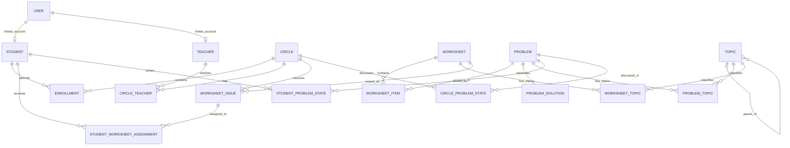
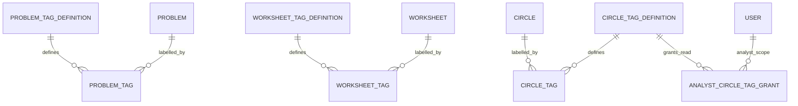

# Модель данных Plusfolio

Задача и листок — неизменяемые опубликованные материалы. Кружок получает листок один раз, школьники получают явные назначения этого листка. Решённость глобальна для пары школьник × задача; разбор локален для пары кружок × задача.

Это логическая модель, без миграций и кода. Исправление опубликованного материала создаёт новый объект с новым ID.

## Основные связи

Кружок допустим без детей, преподавателей и листков. Ожидающие приглашения не являются участием. Профиль школьника создаётся при регистрации и однозначно связан с его аккаунтом.

## Пользователи и участие

| Сущность | Основные поля | Ограничения |
| --- | --- | --- |
| `User` | ID, email, нормализованный email, хеш пароля, набор ролей, активность, подтверждение email | Нормализованный email уникален; допускается несколько ролей |
| `Student` | ID, user_id, отображаемое имя, graduation_year (год окончания 11-го класса), no_patronymic | user_id обязателен и уникален, аккаунт роли школьника; год 1900–2200; NULL только для прежних неполных профилей |
| `Teacher` | ID, user_id, отображаемое имя | user_id обязателен и уникален, аккаунт роли учителя |
| `Circle` | ID, название, описание, город, регион, часовой пояс, created_by, launched_at, архивность | Создаёт администратор; автор не обязан быть преподавателем |
| `Enrollment` | ID, student_id, circle_id, joined_at, left_at, changed_by | Период участия; у одной пары не пересекаются периоды |
| `CircleTeacher` | ID, teacher_id, circle_id, started_at, ended_at, assigned_by | Связь многие-ко-многим с историей; не больше одной активной связи конкретной пары учитель + кружок |

Текущий класс не хранится в БД: начало учебного года — 1 сентября по времени Москвы, `класс = 12 + год начала учебного года − graduation_year`. Например, выпуск 2031 означает 7-й класс в 2026/27 учебном году; летом 2031 ещё показывается 11-й класс, с 1 сентября — «Выпускник». Значение ниже 1 отображается как «Ещё не учится», отсутствие года — «Класс не указан». Это договорённость о прохождении 11 классов; при изменении образовательной траектории преподаватель корректирует ожидаемый год выпуска.

Год общий для школьника во всех кружках. Администратор и действующие преподаватели могут менять его через список текущих участников неархивного кружка; изменения аудируются. Аналитик и школьник только читают. Миграция `0003_student_graduation_year` оставляет существующие записи без года, результаты и участие сохраняются.

Добавление школьника по точному email выполняется через `User` роли школьника и его единственный профиль. Повторное добавление активного участника идемпотентно. Удаление из кружка закрывает `Enrollment`, не удаляя аккаунт и глобальные результаты. Повторное вступление создаёт новый период.

Один кружок имеет несколько активных `CircleTeacher` для разных преподавателей одновременно. Один учитель может иметь активные связи с несколькими кружками. Периоды разных преподавателей в одном кружке могут пересекаться; уникальность активной связи относится только к конкретной паре, а не к кружку целиком. Единственного владельца-преподавателя в модели нет. Закрытие одной связи сохраняет остальные, записи журнала и авторство изменений.

Добавление роли сохраняет остальные роли и связи. Отзыв роли завершает только несовместимые активные связи: снятие student закрывает участие, teacher — преподавание, analyst — grants. Профили и исторические записи не удаляются. Все операции аудируются, действующие права читаются на каждом запросе; массовый отзыв сессий добавляется до размещённого релиза. Полное ФИО и год выпуска школьника обязательны при новой регистрации. Дата рождения, телефон, адрес и школа не входят в минимальную модель.

`launched_at` фиксируется при первом назначении/принятии преподавателя по действию администратора. До этого первый преподаватель добавляется только администратором; после запуска обычные инвайты аналитика могут добавлять следующих преподавателей по принятой иерархии. Завершение всех преподавательских связей не стирает факт запуска.

## Неизменяемый банк материалов

| Сущность | Основные поля | Ограничения |
| --- | --- | --- |
| `Problem` | ID, автор, название, описание, условие, statement_tex (необязательный), состояние, published_at, topic_catalog_version_id, derived_from_problem_id, архивность | Черновик редактируем, публикация фиксирует материал |
| `ProblemSolution` | problem_id, текст решения, solution_tex (необязательный) | Закрытая часть задачи; одна на задачу |
| `Worksheet` | ID, автор, название, описание, состояние, published_at, template_version, topic_catalog_version_id, derived_from_worksheet_id, архивность | После публикации неизменяем |
| `WorksheetItem` | ID, worksheet_id, problem_id, позиция | Позиция и задача уникальны внутри листка |
| `WorksheetIssue` | ID, circle_id, worksheet_id, number, issued_on, recorded_at, issued_by | Уникальные пары кружок + листок и кружок + номер |
| `StudentWorksheetAssignment` | ID, student_id, worksheet_issue_id, enrollment_id, assigned_on, recorded_at, assigned_by, origin | Уникальная пара школьник + выдача листка |

У опубликованной задачи фиксируются название, описание, условие, решение, темы и привязанные теги. У опубликованного листка — название, описание, темы, теги и порядок задач. Неизменяемость действует для автора и администратора; архивность — отдельные изменяемые метаданные доступности, не правка содержимого.

Черновик задачи может быть неполным; публикация требует заполненного условия, решения и хотя бы одной активной темы. Листок публикуется непустым, имеет хотя бы одну активную тему и содержит только опубликованные задачи. Копия получает новый ID; `derived_from_*` показывает происхождение, но не переносит результаты и права автоматически.

Для каждой части задачи предусмотрены обычный текст и необязательный TeX-исходник; публикации достаточно одного из этих вариантов для условия и одного для решения. Если TeX отсутствует, PDF собирается из безопасно экранированного текста. Версия шаблона фиксируется в листке. Выдача получает следующий свободный номер под блокировкой кружка; номер не пересчитывается по датам. Миграция 0004 заполняет номера прежних выдач в порядке даты и ID, сохраняя назначения и результаты.

Целевая модель хранит решение в отдельной закрытой сущности. Неизменяемость защищается серверными операциями и ограничениями БД. В локальной демке решение хранится полем Problem и исключается сервером из ответов школьника; приложение защищает публикации в ORM и M2M-операциях. Отдельная таблица решений и защита от прямых SQL-изменений остаются задачами до рабочего релиза.

## Кому выдали листок

`WorksheetIssue` — выдача всему кружку, `StudentWorksheetAssignment` — факт получения школьником. Это разные уровни. При выдаче листка назначения создаются по периоду участия на дату выдачи; операция, назначения и аудит согласованы транзакционно.

Для добавленного позже школьника все старые листки назначаются автоматически при открытии участия. Новое персональное назначение получает дату вступления и источник automatic_enrollment; исходная дата выдачи кружку не меняется. Повторное вступление не создаёт дубликаты. Создание участия и назначений — одна транзакция.

Период участия и выдача листка не пересчитывают уже созданную когорту автоматически при исправлении даты. Исправление фактов назначений — отдельная аудируемая операция. При ошибочной выдаче сохраняется история её аннулирования; такие факты исключаются из актуальных метрик по явному правилу, а не физически удаляются.

`StudentWorksheetAssignment` содержит `voided_at`, `voided_by`, причину аннулирования. Новое назначение после аннулирования той же пары восстанавливает факт отдельным событием, сохраняя уникальную текущую запись и аудит. `WorksheetIssue` также имеет состояние действительна/аннулирована; повторная выдача той же пары не создаётся даже после аннулирования.

## Решённость и разбор

| Сущность | Уникальный ключ | Состояние |
| --- | --- | --- |
| `StudentProblemState` | student_id + problem_id | solved: boolean, confirmed_at, changed_by, source_circle_id, updated_at, version |
| `CircleProblemState` | circle_id + problem_id | discussed: boolean, solution_visible: boolean, changed_by, updated_at, version |

Значения строго да/нет; отсутствующая запись читается как false. Хранение явного false после первого изменения нужно для версий и аудита, а не для третьего учебного статуса. source_circle_id — происхождение изменения глобального результата, не часть его уникального ключа.

confirmed_at — время записи подтверждения, а не доказанное время решения ребёнком. При снятии отметки текущее подтверждение очищается, прежнее событие остаётся в истории. `version` защищает от потерянных обновлений; отмена также проверяет ожидаемую версию.

Учитель меняет результат, когда школьник сейчас состоит в его кружке и задача выдана в этом кружке. Результат изменится глобально. Остальные задачи и закрытые источники школьника учителю не раскрываются. Аннулирование ошибочного назначения не снимает автоматически факт решения: это независимые операции.

## Общее дерево тем

У задач и листков один общий справочник `Topic`; каждый опубликованный объект связан с одной или несколькими темами. Сама иерархия — дерево с единственным техническим корнем и одним родителем у каждой другой темы.

| Сущность | Поля и назначение |
| --- | --- |
| `Topic` | ID, стабильный уникальный код, parent_id, название, описание, is_other, sort_order, архивность, created_by, timestamps |
| `ProblemTopic` | problem_id + topic_id, уникальная пара; темы задачи |
| `WorksheetTopic` | worksheet_id + topic_id, уникальная пара; темы листка |
| `TopicCatalogVersion` | ID, автор/время изменения, неизменяемый снимок структуры, названий и состояния узлов; версия каталога |

Администратор управляет деревом; учитель выбирает готовые активные темы своих черновиков. Технический корень нельзя назначить материалу, переместить или архивировать. У остальных узлов обязателен родитель, запрещены циклы и перенос под собственного потомка; административные изменения сериализуются транзакционно. Нужны индексы parent_id + sort_order и связей тем в обе стороны.

У корня и каждого обычного узла автоматически создаётся одна дочерняя «Прочее» с `is_other=true`. Такой узел терминальный, со своим стабильным ID и кодом; под ним потомков нет. Уникальность родителя среди узлов `is_other=true` запрещает дубли, а транзакционная операция создания раздела обеспечивает обязательного ребёнка. Системную «Прочее» нельзя менять отдельно от родителя; при переносе или архивации ветки её ID сохраняется. Снимки каталога включают is_other. В интерфейсе эти узлы идут последними и различаются полным путём.

Темы листка выбираются независимо от тем задач. Поиск по ветке включает потомков и дедуплицирует материалы. Привязки опубликованного материала неизменяемы; перенос/переименование узла сохраняет его ID. `topic_catalog_version_id` фиксируется при публикации, а отчёт отдельно сохраняет версию структуры, использованную в группировке. Детали и референс — в [дереве тем](topics.md).

## Три справочника тегов

| Сущность | Назначение и владелец изменения |
| --- | --- |
| `ProblemTagDefinition` | Справочник тегов задач, ведёт администратор |
| `WorksheetTagDefinition` | Отдельный справочник тегов листков, ведёт администратор |
| `CircleTagDefinition` | Отдельный справочник тегов кружков, ведёт администратор |
| `ProblemTag` | Связь задачи с готовым тегом задачи; автор выбирает до публикации |
| `WorksheetTag` | Связь листка с готовым тегом листка; автор выбирает до публикации |
| `CircleTag` | Связь кружка с тегом кружка; назначает/снимает только администратор |
| `AnalystCircleTagGrant` | Право аналитика читать кружки с данным тегом; назначает администратор |

У каждой записи справочника есть ID, стабильный код, название, описание, архивность, created_by и timestamps. Коды уникальны внутри своего справочника; одинаковая надпись в двух справочниках не делает теги одним объектом. Тип тега нельзя поменять. Внешние ключи не позволяют назначить тег листка задаче.

Для доступа аналитика достаточно совпадения хотя бы одного разрешённого тега кружка. Область чтения выражается непосредственно через справочник тегов кружков, назначения которых контролирует администратор.

Архивный тег сохраняется у старых объектов, но не предлагается для новых назначений. Архивация справочной записи сама по себе не отзывает существующие права аналитика; для отзыва администратор снимает grant или тег кружка. Переименование меняет подпись, не идентичность тега; событие сохраняется в истории. Исторические отчёты используют стабильные ID и явно выбранную версию классификации.

## События, аналитика и доставка

| Сущность | Содержание |
| --- | --- |
| `DomainEvent` | event_id, тип, субъект, последовательность/версия агрегата, recorded_at, эффективная дата при наличии, actor, circle_id при наличии, версия схемы, типизированные данные |
| `AuditEvent` | Кто и что изменил, старое/новое значение разрешённых полей, причина, request_id |
| `Invitation` | Нормализованный email, роль, создатель, привязанный кружок или область аналитика, хеш токена, срок, состояние, принявший аккаунт |
| `InvitationCircle`, `InvitationCircleTag` | Типизированные связи области инвайта; для школьника в MVP один кружок |
| `EmailOutbox` | Задание письма, получатель, тип, зашифрованная секретная часть, retry/lease, provider_message_id |
| `EmailDeliveryEvent` | Событие провайдера, ID сообщения/события, статус и время; без содержимого письма и токена |
| `BackgroundJob` | Тип тяжёлого расчёта/индексации, инициатор, фильтры, статус, версия формулы/каталога тем, watermark данных, результат и срок |
| `Attachment` | Позже: закрытый объект, версия хранилища, checksum, принадлежность условию/решению |
| `EmbeddingRecord` | Позже: ID материала, вид текста, модель, размерность, версия подготовки, хеш исходника, статус/ссылка на индекс |

Состояние предметного объекта, событие и аудит записываются в одной транзакции. Это текущие таблицы плюс надёжный журнал изменений, а не переход к полной событийной архитектуре. События позволяют строить производные витрины и векторные индексы с повторной обработкой по event_id.

Аналитические факты получаются из назначений, неизменяемого состава листков и событий решений/разбора. Факт назначения имеет размерность школьник × кружок × выдача × задача; метрика закрытия задачи сворачивает его до уникального школьника в выбранном срезе. Детали — в [аналитике](analytics.md).

## Ограничения и хранение

Основные гарантии: внешние ключи, уникальные пары, обязательные поля, непересечение периодов и проверки диапазонов дат. Межтабличные условия проверяются в транзакционных операциях; обычный CHECK не проверяет данные других таблиц. [Ограничения PostgreSQL](https://www.postgresql.org/docs/current/ddl-constraints.html).

Нужны индексы на нормализованный email; участие/преподавание по кружку и человеку; выдачи и назначения по датам; пункты листка по позиции; глобальные результаты в обе стороны; теги и grants; события по агрегату/версии; задания по статусу/времени следующей попытки. Бизнес-ID — UUID, временные события — UTC, календарные даты выдачи — в часовом поясе кружка.

Опубликованное и использованное не удаляется обычным действием. Архивация сохраняет ссылки, назначения, результаты и отчёты. Удаление персональных данных и его согласование с аудитом, производными индексами и резервными копиями описаны в [резервировании](backups.md).

## Отображение в текущей демке

Это целевая модель, а не дословное перечисление созданных таблиц. В коде демки: `User.roles` — набор ролей; три пространства тегов представлены `Tag.kind` и отдельными M2M-связями; `Solve` соответствует глобальному `StudentProblemState`, `Discussion` — `CircleProblemState`, `Assignment` — персональному назначению. У назначения пока есть время создания, но нет полной схемы эффективных дат, аннулирования и enrollment_id. `AuditEvent` реализован, отдельные DomainEvent, BackgroundJob и EmailDeliveryEvent пока отсутствуют.

Уникальные активные пары участия/преподавания, выдачи, назначения и отметки защищены ограничениями БД. Политики доступа, типы тегов, отсутствие циклов, терминальность «Прочее» и публикация проверяются предметными операциями приложения. Усиление межтабличных гарантий PostgreSQL и проверка прямых административных изменений входят в подготовку размещённой версии.

Показ решения реализован полем `Discussion.solution_visible` (миграция `0002_solution_visibility`) с начальным значением false. Он использует версию и автора общей записи разбор/видимость. CHECK запрещает видимость без разбора. Показ не меняет текст опубликованной задачи или глобальную решённость; изменение и автоматическое скрытие сохраняются в аудите.

Миграция 0005 добавляет `Student.no_patronymic` и производный `User.name_search`. Полное ФИО школьника хранится в `User.name`; нормализованная строка для поиска — NFKC, casefold, е вместо ё, схлопнутые пробелы. При изменении имени поисковое поле обновляется вместе с ним, включая save(update_fields). Для прежних пользователей миграция только строит индекс поиска и не выдумывает ФИО/год. Новая регистрация и редактирование школьного профиля проверяются предметными операциями; старые NULL остаются читаемыми.

## Уточнение: редактируемые личные листки и версии

- `WorksheetDocument(id, author, current_revision, public_revision, copied_from, created_at)` хранит устойчивую идентичность листка и отдельные ссылки на текущую и общую версии.
- `Worksheet(document, revision, …)` — неизменяемый снимок. Уникальность `(document, revision)`. Состав, темы, теги, описание и шаблон принадлежат снимку.
- `WorksheetIssue(document, worksheet, …)` выдаёт точный снимок; уникальность `(circle, document)` сохраняет правило однократной выдачи.
- Копия — новый `WorksheetDocument` с новым автором и ссылкой `copied_from` на исходный снимок. Она личная независимо от статуса источника. Задачи по-прежнему общие и неизменяемые.
- Новая редакция не меняет уже выданные снимки. Публичность — ссылка на выбранную администратором версию; `Worksheet.published` сохраняет технический смысл завершённого неизменяемого снимка.

## Номера задач и внешние источники

`Problem.id` остаётся UUID и используется во всех связях. `ProblemNumber.id` — выделяемый БД постоянный целочисленный номер, связанный с задачей один к одному; название (`title`) необязательно, совпадения названий разрешены. Номер не зависит от порядка вывода.

`source`, `source_id`, `source_url` и `source_metadata` сохраняют исходный номер, ссылку, контрольную сумму, темы/классы/сложность и происхождение. Непустая пара `(source, source_id)` уникальна. Внешний импорт не ищет задачи по названию и не переписывает опубликованные записи. Производная копия получает отдельную идентичность, сохраняя атрибуцию в `source_metadata`, без повторного присвоения уникального ключа импорта.

## Уточнение: раздельное ФИО школьника

Миграция `0015_student_name_parts` использует существующие `User.last_name` и `User.first_name`, добавляет `Student.patronymic`. `User.name` остаётся полным именем для отображения и поиска, собирается из частей при регистрации и сохранении профиля. Все части и год выпуска проверяются на сервере; пустое отчество допустимо только с `no_patronymic=true`. Составные фамилии и имена сохраняются в отдельных полях без повторного разбиения.

Миграция заполняет новые поля из однозначных прежних имён, сохраняет исходное полное имя и уже заполненные части. Неоднозначные старые записи остаются доступны и требуют уточнения в кабинете. Форма ФИО и года общая для регистрации школьника и его личного кабинета.
