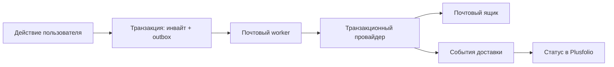

# Доставка писем Plusfolio

В целевой размещённой версии приглашения и восстановление пароля доставляются через транзакционного почтового провайдера. Plusfolio формирует индивидуальные письма и хранит очередь; собственный SMTP-сервер на VPS не закладывается.

Это проект механизма. Провайдер, домен и отправка реальных писем пока не настроены.

## Отправка и надёжность

1. API проверяет роль и область, создаёт инвайт и задание outbox в одной транзакции.
2. Пользователь сразу видит «В очереди». Ответ API не ждёт внешней почты и не обещает доставку.
3. Worker забирает задание с ограниченным временем владения. После сбоя другой запуск сможет повторить обработку.
4. Перед отправкой проверяется, что инвайт действителен, аккаунт отправителя активен, его область не отозвана, получатель не находится в списке блокировки доставки.
5. Через API провайдера отправляется письмо; сохраняются provider_message_id, время и результат.
6. События провайдера обновляют доставку. Их обработка идемпотентна по ID события; проверяется подлинность уведомлений по механизму выбранного провайдера.

Начальный выбор — адаптер API, поскольку для интерфейса важны идентификаторы и события доставки. SMTP можно оставить запасным адаптером, с более ограниченной наблюдаемостью. Конкретный сервис выбирается по региону, доступности, доставке в нужные домены и стоимости перед запуском.

## Статусы

| Состояние доставки | Что означает |
| --- | --- |
| В очереди | Письмо ещё не передано провайдеру |
| Передано провайдеру | Провайдер принял запрос, но получатель ещё не подтверждён |
| Принято почтовым сервером | Есть событие доставки до сервера адресата; это не доказательство прочтения |
| Временная ошибка | Запланирована повторная попытка |
| Постоянная ошибка | Адрес/домен недоступен либо отправка отклонена окончательно |
| Заблокировано | Жалоба, запрет или подавление дальнейших отправок |
| Отменено | Инвайт отозван/истёк до отправки |

Состояние инвайта «принят» устанавливает только действие пользователя, а не статус письма. Открытия писем и клики не требуются для регистрации и не используются как подтверждение принятия.

Почтовые провайдеры могут публиковать события доставки, отказов и жалоб; набор и подписи событий сверяются при подключении адаптера. [Пример официального контракта событий Amazon SES](https://docs.aws.amazon.com/ses/latest/dg/monitor-using-event-publishing.html).

## Повторы, адреса и токены

Временные ошибки и ограничение частоты повторяются с экспоненциальной задержкой, случайным разбросом и конечным лимитом. Постоянный отказ и жалоба останавливают автоматические отправки на адрес; исправление адреса или разблокировка выполняются явно. Скорость ограничена одновременно возможностями провайдера, отправителя и получателя.

Автоматическая доставка имеет семантику «как минимум один раз». При поддержке idempotency key используется ID задания. В случае сбоя после приёма провайдером возможен дубль письма, но ссылка та же и доступ выдаётся однократно. Обещание «ровно одно письмо» не закладывается.

Явное действие «Отправить приглашение заново» отличается от retry: старый токен отзывается, старые неотправленные задания отменяются, создаётся новая ссылка. Предусматриваются короткая пауза между ручными отправками и понятная ошибка после исчерпания попыток.

В `Invitation` хранится хеш токена. Для формирования повторного письма секретная часть временно лежит зашифрованной в outbox с отдельным ключом, который не хранится рядом в БД. После успешной передачи или окончания срока секретная часть удаляется. Ни письмо целиком, ни токен не включаются в аудит и диагностические логи.

Пакетная рассылка — отдельное задание на каждый нормализованный адрес, без общих To/CC. Повторяющиеся адреса внутри пакета удаляются; результат по каждому адресату виден отправителю. Для зарегистрированного школьника используется прямое добавление по email, а не обязательный новый регистрационный инвайт.

## Домен и содержание

Отправка идёт с фиксированного адреса домена проекта. Настраиваются SPF, DKIM и DMARC с выравниванием домена отправителя; проверка выполняется по документации выбранного сервиса. Эти механизмы подтверждают отправляющий домен, но не гарантируют попадание во входящие. [SPF, DKIM и DMARC в документации SES](https://docs.aws.amazon.com/ses/latest/dg/send-email-authentication-dmarc.html).

Шаблон содержит название Plusfolio, роль, кружок/область, отправителя, срок действия и кнопку принятия с текстовой ссылкой. Есть HTML и plain text версии. Решения задач, результаты других детей и список адресатов в письмо не попадают. Текст и имя отправителя экранируются, ссылки собираются только на настроенном домене приложения.

## Контроль перед запуском

Тестовая среда перехватывает письма. До пилота проверяются нужные почтовые домены, несуществующий адрес, задержка, жалоба, дубль события провайдера, сбой worker после отправки, истечение инвайта до доставки и отзыв роли отправителя. Почтовые сканеры могут открывать ссылки, поэтому GET никогда не принимает инвайт.

Наблюдаемость: возраст старейшего задания, доля ошибок и постоянных отказов, лимиты провайдера, срок недоставленного инвайта. После восстановления из бекапа очередь по умолчанию заморожена: старые приглашения не рассылаются автоматически до проверки прав и перевыпуска ссылок.

## Локальная демка и первый провайдер

Сейчас отправка в интернет отключена. Инвайт и зашифрованное содержимое письма создаются одной транзакцией; письмо доступно отправителю и администратору в разделе «Приглашения → Открыть письма». Одноразовая ссылка проходит настоящую проверку срока, адресата, отзыва и текущих прав отправителя.

Для первого размещения выбран адаптер к Yandex Cloud Postbox в российском регионе. Его ещё предстоит реализовать: домен и DKIM/SPF/DMARC, worker с lease/retry, обработка доставки/отказов и ограничения скорости. Действующие тарифы включены в [бюджет](hosting-budget.md). Восстановление пароля не входит в текущую демку. Все адреса примеров вымышленные.
